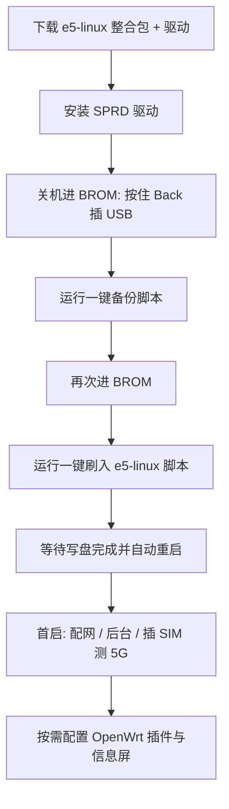

# OpenWrt 专项：荣悦 E5 刷机指南（资料收集）

本文档汇总 **如何把荣悦 E5（键盘 5G 老人机）刷成 OpenWrt 向的随身路由系统**。仓库**不托管固件**，只收录公开教程与链接；动手刷机请在 **Windows** 主机上按作者最新包操作（Mac 见 [macos-flashing.md](macos-flashing.md)）。

---

## 先认清：这是哪种「E5」？

| 设备 | 芯片 | 与本文关系 |
| --- | --- | --- |
| **荣悦 E5 / RongYue E5**（本仓库主题） | 展锐 **T158** | ✅ 社区 **e5-linux** 整包路线 |
| **Reyee / 锐捷 AX3200 E5** 路由器 | 联发科 **MT7622** | ❌ **不是同一台机器**；该机有 [官方 OpenWrt 支持](https://github.com/openwrt/openwrt/pull/10951)，刷法为 UART + TFTP，与手机无关 |

在 [OpenWrt Firmware Selector](https://firmware-selector.openwrt.org/) 搜索「E5」只会出现路由器型号，**不能**给荣悦手机下载固件。

---

## 荣悦 E5 上的「OpenWrt」是什么？

- **不是** 从 openwrt.org 下载 `sysupgrade.bin` 直刷。
- 社区方案是刷入 **e5-linux**（作者描述为基于 Linux 的随身 WiFi / 路由系统，带 OpenWrt 式插件能力；用户态/内核许可证以作者 GitHub 为准，报道中常见 **系统 MIT、内核 GPL** 表述）。
- 刷机方式：**展锐 BROM + QuTick102 体系 `spd_dump` + 整包写入 eMMC**（「整包替换」），与中兴 F50（T760）常见的 **TF 卡双系统 OpenWrt** 不是一条路。

平台选型与 F50 对比：[什么值得买 — T158 与 T760](https://post.smzdm.com/p/agg58n3m/)、[十月随身 WiFi 刷 OpenWrt 三条线](https://post.smzdm.com/p/avgprw87/)。

---

## 教程与资料索引

### 主教程（建议从这里跟）

| 类型 | 链接 | 说明 |
| --- | --- | --- |
| **视频（主）** | [老人机刷上 openwrt 改造随身 WiFi — 荣悦 E5](https://www.bilibili.com/video/BV1htpJ6NECu/) | UP 方阿成；e5-linux 整包、信息屏、GitHub/网盘一般在**简介与置顶评论** |
| **视频（生态背景）** | [中兴 F50 / 老款 U20 刷 OpenWrt 双系统](https://search.bilibili.com/all?keyword=%E4%B8%AD%E5%85%B4F50%20OpenWrt%20%E5%8F%8C%E7%B3%BB%E7%BB%9F) | **T760 路线**，仅供对比，勿用其固件刷 E5 |
| **图文** | [百元随身 WiFi 刷 OpenWrt：分清 T158 与 T760](https://post.smzdm.com/p/agg58n3m/) | 购机、芯片、预期管理 |
| **图文** | [随身 WiFi 刷 OpenWrt：E5 / F50 三条线](https://post.smzdm.com/p/avgprw87/) | e5-linux 整包、项目迭代节奏、社区评价 |
| **测评向** | [荣悦-E5 @ MIFIPK](https://mifipk.com/en/devices/32) | 作 MiFi 时的频段、延迟（多基于 UFI-TOOLS/Android 向测试，可作购机参考） |

### 工具与固件来源（以视频/包内说明为准）

| 资源 | 链接 | 说明 |
| --- | --- | --- |
| **QuTick102 工具/资源** | http://qutick102.ysepan.com/ | 需密码；定制 `spd_dump` 常由此体系分发 |
| **官改 Android（非 OpenWrt，但同工具链）** | https://1816129281.share.123pan.cn/123pan/7oa5Vv-4vx03 | [MiniKano 教程](https://www.bilibili.com/video/BV1e65y69E3L/) 引用；可先熟悉 BROM 与 spd_dump |
| **展锐通用刷机知识** | [Unisoc.md](https://github.com/ig25138/KDXF-LEAKiNG-Project/blob/main/Unisoc.md) | 驱动、备份命令思路；**FDL 勿照搬** |
| **开源 spd_dump（参考）** | [TomKing062/spreadtrum_flash](https://github.com/TomKing062/spreadtrum_flash) | e5-linux 教程多用 QuTick102 闭源/定制版，与开源版命令可能不完全一致 |
| **e5-linux 源码/发布** | _见 BV1htpJ6NECu 简介_ | 固定 GitHub URL 易变；若你找到稳定仓库链接，欢迎向本仓库 PR 补充 |

### 相关但非 OpenWrt 的路线

| 链接 | 说明 |
| --- | --- |
| [荣悦 E5 刷机 + UFI-TOOLS](https://www.bilibili.com/video/BV1e65y69E3L/) | 留在 **Android 官改** + UFI-TOOLS，可当专业 MiFi，**不是** e5-linux |
| [Hovatek — T158 / RongYue E5](https://www.hovatek.com/forum/thread-49605.html) | Flyme 移植、KernelSU-Next 等 **Android** 向 |

---

## 刷成 OpenWrt（e5-linux）前：前提检查

在 Windows 上动手前，建议逐项确认：

1. **SoC**：展锐 **T158**（勿与 T760、T157 混包）。
2. **内存**：常见 2GB 或 3GB RAM，固件若标注仅适配某一档位，必须一致。
3. **备份**：接受刷机可能变砖；准备 **全盘或至少 boot/system 等关键分区备份**（包内常有 `01一键备份.bat` 类脚本）。
4. **环境**：**Windows 10/11**、管理员权限、**Spreadtrum USB 驱动**（包内 `SPRD_Driver_R4.x`）、原装或可靠 **Type-C 数据线**。
5. **预期**：系统仍在快速迭代；5G SA/频段、Wi‑Fi 发射功率、续航（社区有 **约 6–8 小时** 热点量级说法）可能不如中兴 F50 等成熟 CPE。
6. **合规**：使用正规 SIM；勿使用改串等违法功能。

刷机环境若只有 macOS：见 [macos-flashing.md](macos-flashing.md)（**可用，但不建议**作首次整包刷入）。

---

## 推荐操作流程（Windows，逻辑步骤）

以下步骤归纳自社区公开描述，**具体文件名、按键、脚本名以你下载的 e5-linux 整合包为准**（跟 [BV1htpJ6NECu](https://www.bilibili.com/video/BV1htpJ6NECu/) 最新版）。

### 1. 获取整合包

- 打开 [BV1htpJ6NECu](https://www.bilibili.com/video/BV1htpJ6NECu/)，从简介/评论进入 **GitHub Release 或网盘**。
- 解压到**纯英文路径**（部分展锐工具对中文路径敏感）。
- 确认包内含有：`spd_dump`（或 `.exe`）、`fdl1`/`fdl2`、`gpt.xml` 或分区列表、系统镜像、`.bat` 刷机脚本。

### 2. 安装驱动

- 运行包内或 [Unisoc.md](https://github.com/ig25138/KDXF-LEAKiNG-Project/blob/main/Unisoc.md) 提到的 **DPInst64** 安装展锐驱动。
- 设备管理器中 BROM 下应出现 Spreadtrum / UNISOC 相关端口（而非未知 USB 设备）。

### 3. 进入 BROM（下载模式）

- **关机**（可拆电池机型建议断电更稳妥）。
- **按住 Back（返回键）**，连接 USB 至 PC（部分文档写「先按 Back 再开机」，以整合包 README 为准）。
- 打开 `spd_dump` 或一键脚本，确认工具已识别设备。

### 4. 备份（强烈建议）

- 运行包内 **备份用 `.bat`**（名称可能是 `backup`、`一键备份` 等）。
- 等待分区镜像完整写入 PC 硬盘；校验文件大小非 0。
- 将备份复制到第二块磁盘或云盘。

### 5. 刷入 e5-linux

- 再次进入 BROM。
- 运行 **刷机 `.bat`**（可能包含擦除 `userdata`、多分区写入、`reset`）。
- **刷写过程中勿拔线、勿休眠**；耗时可能数十分钟。

### 6. 首启与验证

- 首启可能较慢；按作者说明连接 Wi‑Fi 后台（IP/密码见视频或 GitHub）。
- 插入 SIM，测试 4G/5G 注册、热点、USB 上网（若支持）。
- 可选：配置机身上的 **信息屏**（主教程提及的开源信息屏项目，链接以作者为准）。

### 7. 升级与回退

- **升级**：关注作者 GitHub/群公告，通常再次 BROM + 新整合包；是否支持增量以说明为准。
- **回退**：若有步骤 4 的完整备份，用包内恢复脚本或 `spd_dump` 写回对应分区（操作与刷入类似，写错分区风险高）。

---

## 与「中兴 F50 OpenWrt」差异（避免下错包）

| 项目 | 荣悦 E5（T158） | 中兴 F50 / 老款 U20（T760） |
| --- | --- | --- |
| OpenWrt 形态 | **e5-linux 整包刷 eMMC** | 社区 **双系统 / TF 卡** 等方案更成熟 |
| 工具 | QuTick102 `spd_dump` + E5 专用 FDL | F50 专用工具链与镜像 |
| 社区沉淀 | 较新，按周修 bug | 数年积累，问题易搜到 |
| 适合人群 | ~150 元尝鲜、接受实验性 | 长期插件、组网主力 |

---

## 已知限制与风险（刷前必读）

- **变砖**：错误 FDL、中断刷写、混用他机分区表可能导致无法开机；依赖备份与 BROM 救砖经验。
- **非官方 OpenWrt**：插件、内核模块与上游 OpenWrt 目标机 **不通用**。
- **性能与射频**：手机形态天线、USB2.0 等限制吞吐与稳定性。
- **保修与合规**：刷机失保；遵守当地电信法规。

---

## 文档维护

- 主 README：[../README.md](../README.md)
- macOS 环境：[macos-flashing.md](macos-flashing.md)
- 发现新教程、稳定 GitHub 镜像或勘误，请 PR 修改本页或开 Issue。

**免责声明**：本页为资料索引，不构成对任何固件安全性的担保；刷机后果自负。
